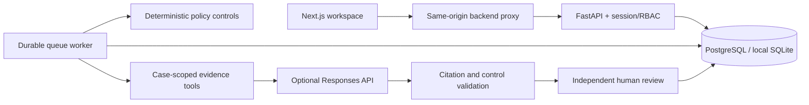

# Governed investigation platform

## User journey

1. Start the platform and sign in as an analyst.
2. Select one of the synthetic cases and queue an investigation with an objective.
3. The worker evaluates deterministic controls, captures the case facts, recorded customer cases and active policy, then retrieves relevant chunks from uploaded policy documents.
4. Offline mode creates a clearly labelled deterministic brief. Live mode lets the model call `read_evidence` in a bounded Responses API tool loop and return a structured brief.
5. The backend validates citation IDs, exact quotes, required findings, missing evidence, and conflicts with hard controls.
6. A different reviewer approves, rejects, or requests changes. The review is atomically bound to the exact proposal hash and saved evidence snapshot. Approved investigations do not execute financial side effects.
7. Export the brief, snapshot, event trace and review history as JSON.



## Implementation boundaries

- Internal, single-organisation workspace: all authenticated staff can read the shared case queue. Multi-tenant isolation is not implemented.
- Opaque 8-hour database sessions use hashed tokens, HttpOnly cookies and salted scrypt password hashes. Production cookies require HTTPS. Cross-origin mutations are checked against configured origins; same-origin proxying avoids cross-site cookies.
- Administrator accounts manage policy evidence and can create team accounts. Password changes revoke all of the account's sessions. Bootstrap accounts are created only if absent; changing the environment password never resets existing passwords.
- Separate worker processes claim jobs using a conditional database update. Leases expire after six minutes and recover jobs after a crash. Failed jobs can be manually retried up to three attempts. Review changes start a new proposal revision, retain the original snapshot and review history, and invalidate the previous approval hash.
- Events record tool calls, snapshot/proposal hashes, model usage, failures, and human review. These are ordinary database records, not a cryptographically tamper-proof audit ledger. Keep database backups and restrict database access.
- Uploaded policy text is immutable through the API, content-addressed and deduplicated. Retrieval uses overlapping 1,600-character chunks and lexical relevance. This is not an embedding/vector retrieval implementation. Global uploads accept policy documents only; customer facts remain case-scoped.
- The live loop allows at most five model requests, four tool calls per request, 2,000 output tokens per request, and 24,000 cumulative reported tokens. The elapsed-time check runs before requests at 180 seconds, with a 40-second HTTP timeout. These bounds control usage; they are not an exact currency spending guarantee. A provider failure is visible and never silently falls back to demo output.
- Citation validation establishes quote provenance, not semantic entailment. It does not prove that every generated claim follows from a quotation. The included offline evaluation measures deterministic routing/control behaviour, not live model factuality, fairness, or regulatory compliance.
- The original risk scores and fairness flags remain demonstration rules. This is a synthetic-data portfolio platform, not a certified financial decision system.

## Configuration

| Variable | Purpose |
| --- | --- |
| DATABASE_URL | SQLite locally, PostgreSQL via psycopg in Compose/hosting |
| BOOTSTRAP_PASSWORD | At least 12 characters; creates initial analyst/reviewer/admin accounts only if absent |
| APP_ENV | `production` enables Secure session cookies and disables automatic schema creation |
| SEED_ON_STARTUP | Seed synthetic cases; disable for non-demo deployment |
| CORS_ORIGINS | Exact frontend origins permitted to mutate data |
| OPENAI_API_KEY | Optional server-only live model credential |
| OPENAI_MODEL | Explicit model ID available to the configured account |
| BACKEND_URL | Frontend proxy destination; supplied at Next.js build time for deployed builds |

Use distinct individual accounts and passwords for actual team use. The generated local bootstrap password is stored in ignored `.local/credentials.txt` for the workspace owner. Do not upload `.env`, `.local`, databases, logs or model credentials.

## APIs

All data endpoints require a session cookie. `GET /health` and `POST /auth/login` are public. Interactive schemas remain at `/docs`.

| Method/path | Role / behaviour |
| --- | --- |
| POST /auth/login | Issue session cookie |
| GET /auth/me | Current account |
| POST /auth/logout | Revoke current session |
| POST /auth/password | Change password and revoke all sessions |
| POST /accounts | Admin creates analyst/reviewer/admin account |
| GET /investigations/config | Live provider availability, without secrets |
| GET /investigations | Latest 100 investigations |
| POST /investigations | Analyst/admin queues case, objective and provider |
| GET /investigations/{id} | Saved state, evidence, events, reviews |
| POST /investigations/{id}/retry | Analyst/admin retries a failed run |
| POST /investigations/{id}/review | Reviewer/admin, different from creator; requires current proposal hash, decision and rationale |
| GET /investigations/{id}/export | Download complete JSON report |
| GET /evidence | Policy document metadata |
| POST /evidence | Admin uploads plain-text policy evidence |

Legacy APIs are also protected. Policy changes require admin; case creation/evaluation requires analyst/admin; review decisions require reviewer/admin and use the authenticated reviewer identity.

## Database migrations

For a new database:

```sh
cd backend
python -m alembic upgrade head
python -m alembic check
```

The baseline migration contains a frozen schema for both legacy and new tables. For an existing database, back it up first. Because the original application had no migration history, do not blindly run or stamp the baseline on an existing database. Compare its schema to the baseline and migrate/copy records into a fresh migrated database with a reviewed data migration. The supplied launcher uses a new checkout-local database.

## Validation

```sh
cd backend
python -m pytest -q --disable-warnings
python -m app.evaluate
python -m alembic check
cd ../frontend
npm ci
npm run typecheck
npm run build
npm audit
```

Browser tests require the running platform and its initial local password in `E2E_PASSWORD`. Set `PLAYWRIGHT_CHANNEL=chrome` to use an installed Chrome, or install the matching Playwright Chromium with `npx playwright install chromium`. Run `npm run test:e2e`. Tests cover desktop and mobile analyst creation, cited output, independent reviewer approval, audit availability and horizontal overflow. Passwords are read from the environment, never committed.

Live provider tests use mocked HTTP transport to exercise actual request construction, tool output, structured output parsing and usage accounting without spending API credits. No live provider quality benchmark is claimed. `evaluation/cases.jsonl` holds reproducible offline routing scenarios; `.local/evaluation.json` records their outcomes and latency.

## Hosting and operations

Compose runs PostgreSQL, API, worker and production-built Next.js. For hosted use, deploy all four components on a container-capable host, persist PostgreSQL, set `APP_ENV=production`, use HTTPS, configure the exact public frontend origin, set `BACKEND_URL` during frontend build, and disable synthetic seeding. Run Alembic once as a release step before API/worker rollout. Keep the API private behind the same-origin frontend proxy when possible. Configure reverse-proxy request limits and distributed login throttling for multiple API replicas; the included login limiter is per-process.

Inspect queued/running/failed counts in the investigation list and tool/usage details in each event trace. Worker errors go to stderr with a run ID; public errors omit provider response bodies. Set alerts on growing queues, recurring failed runs and expired leases. Back up PostgreSQL and test restore procedures. No hosting account or external live endpoint is provisioned by these files.

Stop locally managed processes with `Stop-Platform.ps1`; it checks saved process start times before terminating them. Logs are in `.local/`. To restart after a configuration change, stop and run the launcher again.
